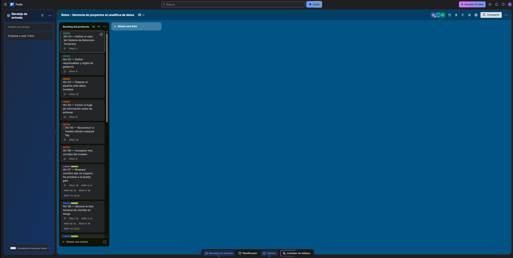

\# Bitácora del Reto 01 — Equipo GJJJ

\## PS-2 — Prueba de humo

\- Fecha: 24 de octubre de 2026.

\- Repositorio: https://github.com/juanm0119/srt-v2-gjjj

\- Variante asignada: V2.

\- Entorno utilizado: Windows, Visual Studio.

\- Generacion de los roles principales y secundarios para los intrgantes del grupo. ver ##6 de charter.md

\- Creacion de los riesgos encontrados. Entre los que se encuentra la habilidad mas debil de equipo y como mitigarla (R-01)

\- El rol de Lider para a Jorge Andres Sanchez

### Reglas para aplicar la RACI

1. **Contrato de datos.** Data Steward prepara los hallazgos y propuestas; el Dueño del dato aprueba los cambios. Las reglas canónicas se conservan.
2. **Quality gate.** Data Scientist sustenta la propuesta; MLOps implementa y verifica la configuración. El Líder / PO conserva la A y debe contar con aprobación del Comité. Se registra la decisión y su evidencia.
3. **Umbral de negocio.** El Sponsor decide `model.decision_threshold` con evidencia del Data Scientist y considerando capacidad, impacto y equidad. Este umbral se distingue del umbral fijo de evaluación del gate.
4. **Equidad.** Data Scientist y Data Steward analizan la brecha y presentan alternativas. El Comité, presidido por el docente, decide la brecha aceptable.
5. **Promoción.** El Líder / PO decide y MLOps ejecuta. Se exige un `reports/gate.json` con `passed: true` antes de promover una versión a `@champion`.
6. **Rollback.** El Líder / PO decide y MLOps ejecuta la reversión. Se registran el momento de la decisión, la versión recuperada y la comprobación del servicio.
7. **LLM externo.** El Sponsor autoriza el envío. Antes de ejecutarlo, se revisan los datos y se aplican las exclusiones: el LLM no recibe `customer_id`, `senior_citizen` ni columnas no canónicas.
8. **Suplencias.** Se registra quién ejerce cada rol durante la sustitución. En promoción y rollback, la persona que decide debe ser distinta de la que ejecuta. Si Juan Manuel ejecuta como MLOps secundario, Jorge Andrés podrá ejercer como Líder / PO secundario mediante una suplencia registrada.
9. **Comunicación y evidencia.** Quien ejecuta documenta el resultado; quien tiene la A confirma la decisión o aceptación y asegura que se informe a los roles I. Las decisiones se registran en `docs/decision_log.md` con evidencia verificable.

## Tablero del backlog

- Enlace: [Trello — Retos - Gerencia de proyectos en analítica de datos](https://trello.com/b/szznOU9w/retos-gerencia-de-proyectos-en-analitica-de-datos)
- Contenido verificado el 2026-10-29: HU-01 a HU-17 con Effort; las siete historias de operación (HU-07, HU-08, HU-09, HU-10, HU-11, HU-16 y HU-17) con la etiqueta OPERACIÓN y PERT (O / M / P / Te); las 17 historias con su etiqueta de fase CRISP-ML(Q); tarjeta del spike (3 h, responsable: MLOps Engineer).

## PS-1 · La prueba del incidente (RACI)

| Caso | Fila de la RACI (charter §6) | Decide (A) | Ejecuta (R) | Se informa (I) |
|---|---|---|---|---|
| 1. Lunes 07:10: el lote viola una regla bloqueante del contrato | Despliegue y monitoreo. Si hay que cambiar el contrato: Contrato de datos y sus cambios | Líder / PO. El cambio del contrato lo decide el Dueño del dato | MLOps Engineer: no se puntúa el lote (CRÍTICO-CONTRATO), se registra en `reports/rejected/<lote>.json` y se notifica al Dueño del dato. Data Steward: prepara los hallazgos | Sponsor, Comité |
| 2. Martes: la versión promovida ayer tiene errores > 10 % en la API | Rollback ante incidente | Líder / PO | MLOps Engineer: `@previous` → `@champion` y verificación en `/health` (< 30 min) | Sponsor, Dueño del dato, Comité |
| 3. El nuevo `@challenger` mejora el roc_auc, pero su brecha de equidad supera la política | Brecha de equidad aceptable (y Promoción a `@champion`) | Comité | Data Scientist y Data Steward: analizan la brecha y presentan alternativas. No se promueve hasta que el Comité decida (HU-13) | La fila no tiene I: Sponsor, Líder / PO, MLOps y Dueño del dato son C (consultados) |
| 4. El Data Scientist propone usar la Claude API con datos del extracto | Envío de datos a un proveedor de LLM externo | Sponsor | MLOps Engineer, solo si el Sponsor lo autoriza. El LLM nunca recibe `customer_id`, `senior_citizen` ni columnas no canónicas (contrato §12.5) | La fila no tiene I: Líder / PO, Data Scientist, Data Steward, Dueño del dato y Comité son C |

## PS-2 · El plan cabe en la capacidad

    Capacidad   = 62 h/semana × 2 semanas × 0,60 − 7,44 (reserva 10 %) = 66,96 h
    Comprometido = 145 h pendientes (148 h con el spike − 3 h de HU-01, entregada en el Reto 00)
    OBSERVAR: Comprometido (145) > Capacidad (66,96) → déficit de 78,04 h,
              decidido y registrado: charter §7.1, decision_log.md (2026-10-29) y riesgo R-07.

## PS-3 · Los riesgos cubren todas las categorías

    datos      1
    modelo     1
    operación  1
    ética      1
    gestión    2
    LLM        1
    OBSERVAR: ningún conteo en 0.

## Historia peor estimada

HU-11 (rollback en menos de 30 minutos): tiene el mayor rango PERT del backlog (P − O = 14 h), es la única XL, es de operación y se reparte entre los Retos 03 y 05. Acción: dividirla en HU-11a (Reto 03) y HU-11b (Reto 05). Detalle en charter §7.5 y decision_log.md.

## Quién hizo qué

| Integrante | Aporte al Reto 01 |
|---|---|
| Juan Manuel Adarve Cifuentes (Líder / PO) | [pendiente] |
| Jorge Eliecer Leighton Romero (MLOps Engineer) | Charter §7: tabla resumen del backlog y enlace al tablero, capacidad y decisión del déficit, marco de gestión, DoD, cronograma e historia peor estimada (§7.1–§7.5). Además, el KPI de rollback (§4), el ajuste de roles en §1, R-07 en riesgos.md, el spike en Trello, los registros en decision_log.md. |
| Jorge Andrés Sánchez Martínez (Data Scientist) | Charter §8: riesgos principales y enlace a riesgos.md. |
| Gloria Abimeleth Ardila Guerrero (Data Steward) | Charter §1 a §6: roles principales y secundarios, RACI y reglas para aplicarla.|